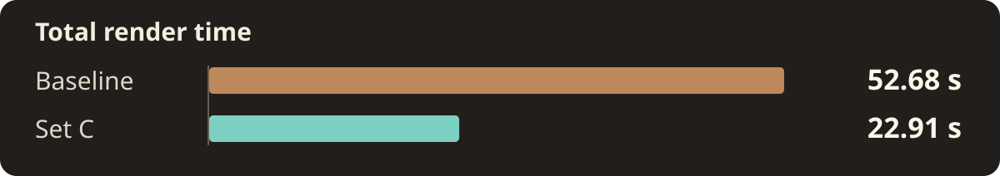
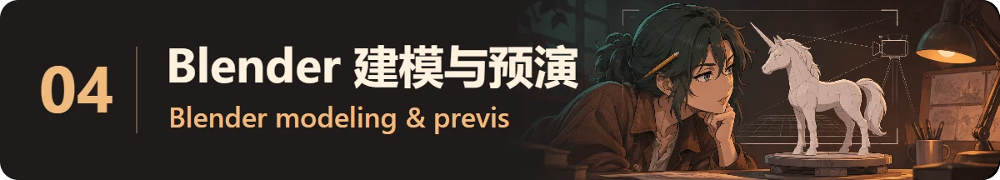
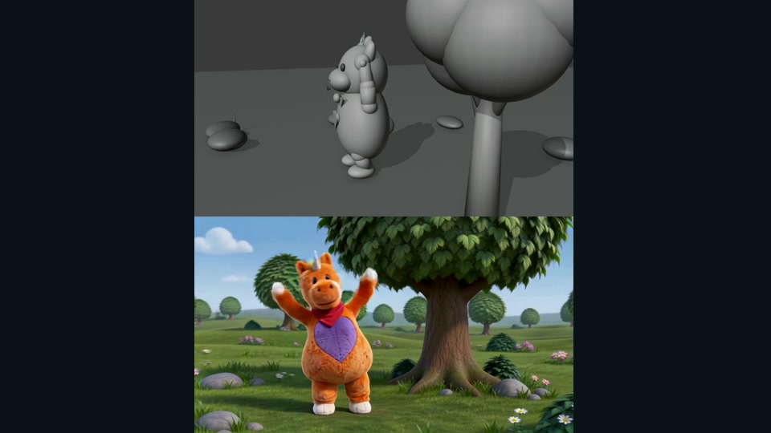
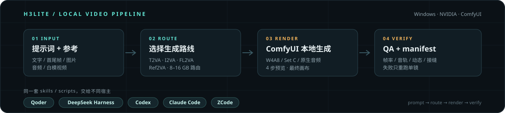

# H3 Lite

<p align="center">
  <picture>
    <source media="(prefers-reduced-motion: reduce)" type="image/webp" srcset="assets/readme/hero-still.webp">
    <source media="(max-width: 640px)" type="image/webp" srcset="assets/readme/hero-mobile.webp">
    
  </picture>
</p>

<p align="center">
  
</p>

<p align="center">
  <a href="README.md">中文</a> | <strong>English</strong> | <a href="https://github.com/Rimagination/h3lite/blob/v0.2.0/qoder-plugin/CHANGELOG.md#新能力">更新说明</a>
</p>

**H3 Lite lets you make AI videos with sound on your own computer.** Tell your AI assistant what you want to film or give it an image to start from. It will choose a workflow for your GPU and use MiniMax H3 to generate a clip with ambience, sound effects, or dialogue. For a short film, H3 Lite can also help you plan and preview shots, generate them one at a time, and edit them together.

<p align="center">
  <a href="#sample-clips">Sample clips</a> · <a href="#quick-start">Quick start</a> · <a href="#hardware-and-models">Hardware and models</a> · <a href="#blender-modeling-and-previs">Blender modeling and previs</a> · <a href="#production-workflow">Short film workflow</a>
</p>

<a name="sample-clips"></a>

## 

Select a thumbnail and turn on the sound. H3 Lite generated both the picture and the audio you hear in these clips.

<table>
  <tr>
    <td align="center" width="50%">
      <a href="https://rimagination.github.io/h3lite/?video=case-red-ball"></a><br>
      <strong>Bouncing red ball</strong><br><sub>5-second test · impacts and rolling sound</sub>
    </td>
    <td align="center" width="50%">
      <a href="https://rimagination.github.io/h3lite/?video=case-golden-retriever"></a><br>
      <strong>A puppy wakes up</strong><br><sub>Timed prompt · from sleeping to stirring</sub>
    </td>
  </tr>
  <tr>
    <td align="center" width="50%">
      <a href="https://rimagination.github.io/h3lite/?video=case-familyguy"></a><br>
      <strong>Changing the channel</strong><br><sub>Image to video · starts from a supplied frame</sub>
    </td>
    <td align="center" width="50%">
      <a href="https://rimagination.github.io/h3lite/?video=case-starship-jump"></a><br>
      <strong>Starship jump</strong><br><sub>8-second text-to-video clip · cuts and jump sounds</sub>
    </td>
  </tr>
</table>

[Browse the full gallery, including ZCode and Qoder examples](https://rimagination.github.io/h3lite/) · [Compare Set A acceleration settings](https://rimagination.github.io/h3lite/?video=seta-lightx2v-compat)

<a name="quick-start"></a>

## 

Start on **Windows with an NVIDIA GPU**. H3 Lite runs ComfyUI on your computer and can reuse a working installation. Install the plugin and models separately. For model downloads, see [Hardware and models](#hardware-and-models).

### 1. Add H3 Lite to your AI assistant

| Your assistant | Where to start |
| --- | --- |
| **Codex / Claude Code** | For a single clip, use the root [`SKILL.md`](SKILL.md) and keep its `scripts/`, `references/`, and `assets/` alongside it. For the full workflow, choose from the [six standalone skills](qoder-plugin/skills/). |
| **Qoder** | Download the [v0.2.0 plugin ZIP](https://github.com/Rimagination/h3lite/releases/download/v0.2.0/h3lite-0.2.0.zip) and follow the [installation guide](qoder-plugin/README.md#安装与升级). |
| **DeepSeek Harness** | Download or clone the repository. In **Plugins → Add plugin**, select the local `dsh-plugin` directory. [Setup guide](dsh-plugin/README.md#安装到-dsh) |
| **Standard MCP client** | Run the bundled MCP server with Node.js and point it at your ComfyUI installation. [Launch and configuration](dsh-plugin/README.md#可选标准-mcp) |

### 2. Check your machine before downloading models

Paste this into an assistant that can access your files and run terminal commands.

```text
Read the README at https://github.com/Rimagination/h3lite.
I want to make a five-second test clip with native audio. Check my GPU, RAM,
disk space, and any existing ComfyUI installation. Recommend a component set
and reuse a working installation. Tell me the download size and destination
before downloading any models.
```

### 3. Render the five-second red-ball test

Check three things when it finishes. The ball bounces twice, you hear two impacts, and the MP4 plays.

```text
Use H3 Lite to make a five-second 640×352 landscape clip with the fast profile
and native audio. Use a fixed low-angle camera. A matte red rubber ball bounces
twice on gray concrete, then rolls out of frame to the right. Keep the two
impacts and the rolling sound. Leave out music. Return the MP4 path and check
the duration, audio track, and motion.
```

### Decide what to give the model

| What you want to control | What to give your assistant | Mode |
| --- | --- | --- |
| Create a scene from words | Describe the picture, action, and sound in playback order | `T2VA` |
| Start from a specific image | The opening image and what happens next | `I2VA` |
| Connect two images | The start and end frames, plus the action and camera move between them | `FL2VA` |
| Reuse a character, movement, or voice | At least one reference image, optional video or audio, and a role for each reference | `Ref2VA` |

Try the [original first frame from the TV scene](assets/examples/h3lite-i2va-familyguy-first-frame.png) or view the [official MiniMax Ref2VA input example](https://rimagination.github.io/h3lite/?video=case-pink-lamb-reference). [Prompt guide and examples](qoder-plugin/skills/h3-prompt/references/prompt-writing.md)

<a name="hardware-and-models"></a>

## 

Choose a component set based on your **NVIDIA GPU's VRAM**. System RAM and the workflow also affect the resolution you can use. Start at 640×352 before trying a larger frame. Use [`h3-workstation`](qoder-plugin/skills/h3-workstation/SKILL.md) to check the GPU, model components, and ComfyUI installation.

| Where to start | Component set | Download |
| --- | --- | --- |
| **8 GB VRAM**, tested on an RTX 4070 Laptop with 32 GB RAM | **Set A** · Low VRAM | [Baidu Netdisk](https://pan.baidu.com/s/1IBlH0VY7tWGvxqMtniraow) · `4hri` |
| **16 GB VRAM**, tested on an RTX 4060 Ti with 32 GB RAM | **Set B** · FP8 compatibility | [Baidu Netdisk](https://pan.baidu.com/s/1x5GGuJv0h8chApgVoDgIaQ) · `1hjx` |
| **16 GB with acceleration**, install Set B first | **Set C** · Selected automatically at supported resolutions when its components are present | [Downloads and checksums](qoder-plugin/README.md#set-c-资产网盘) |

If you use Ref2VA with Set C, install the additional reference-generation weights listed in the download guide.

### How much time can Set C save?

On one RTX 4060 Ti 16 GB, total time for a **640×352, 124-frame, four-step** clip went from **52.68 s** to **22.91 s**. Resolution, shot length, and hardware all affect render time. [Test conditions and other resolutions](qoder-plugin/skills/h3-workstation/references/deployment-matrix.md#validated-16-gb-acceleration-ladder-2026-11-19-set-c-overlay)

<p align="center">
  
</p>

<details>
<summary><strong>Platform support, grid seams, and VRAM troubleshooting</strong></summary>

- **Other platforms.** Apple Silicon users can try the independent [community MLX port](https://huggingface.co/yunfengwang/mmh3turbo-bundles). The H3 Lite workflow is unverified on Linux with NVIDIA and on Intel Macs.
- **A grid appears on smooth backgrounds.** Set C's Sol VAE can leave 128 px seams. Run `h3_grid_check.py` and try the standard FP16 video VAE via `--video-vae` if the check flags suspected seams. [Components and test results](qoder-plugin/skills/h3-workstation/references/component-sets.md)
- **An RTX 50-series GPU produces fixed textures or ignores prompts.** Test two prompts at a small resolution with the same seed. If the quantized route shows the issue, see the [Blackwell troubleshooting guide](qoder-plugin/skills/h3-workstation/references/deployment-matrix.md#blackwell-and-quantized-h3-known-upstream-risk) for the FP8 DiT workaround.
- **A render runs out of VRAM or stalls.** Render one shot at a time on the 16 GB route. Check other CUDA processes and models still in memory. Split long videos into shots and keep the per-shot manifests. [GPU contention guide](qoder-plugin/skills/h3-workstation/references/gpu-contention.md)

</details>

<a name="blender-modeling-and-previs"></a>

## 

When you want the camera to circle a subject or a character to follow a path, block out the character, props, and scene with simple shapes in Blender. Render a short preview of the motion and give H3 the video as a reference.

<p align="center">
  <a href="https://rimagination.github.io/h3lite/?video=zcode-blender-unicorn-compare"></a>
  <br>
  <a href="https://rimagination.github.io/h3lite/?video=zcode-blender-unicorn-compare"><strong>Play the toy unicorn workout · 10.8 seconds</strong></a>
  <br>
  <sub>Blender blockout on top, H3 render below. Watch how the camera moves around the unicorn as it stretches.</sub>
</p>

### Prepare a shot in Blender

1. **Block out the scene.** Use [`h3-whitemodel`](qoder-plugin/skills/h3-whitemodel/SKILL.md) to place the subject, floor, and props. Check their position and scale in the frame.
2. **Plan the movement.** Keyframe the subject and camera, then preview the shot to check direction, occlusion, and framing.
3. **Export the preview.** Save a clear video of the action and camera move for Ref2VA. Keep a separate character reference image to guide the character's appearance.

See the [short film workflow](#production-workflow) for how to use these references in a multi-shot project.

[Blender workflow](qoder-plugin/skills/h3-whitemodel/SKILL.md) · [Use a blockout video in Ref2VA](qoder-plugin/skills/h3-whitemodel/references/h3-video-reference.md) · [Blender examples in the gallery](https://rimagination.github.io/h3lite/#blender-gallery)

<a name="production-workflow"></a>

## 

**After trying different shot plans, references, and generation settings, we used this workflow to automatically make a 3:25 short film.**

[Watch the finished film, *The Chanting Next Door: Never Let It Stop* · Kamishibai Horror, Episode 1](https://www.bilibili.com/video/BV1j8y8zgE1H/)

Given a story, character references, and a target runtime, the agent breaks the film into short shots, generates and checks each one, then edits them into a finished video.

<p align="center">
  
</p>

### How the automation works

1. **Plan the shots and write the prompts.** [`h3-director`](qoder-plugin/skills/h3-director/SKILL.md) breaks down the story. It records recurring characters, settings, and voices in `canon.json`, and each shot's references, target length, and acceptance criteria in `show.json`. [`h3-prompt`](qoder-plugin/skills/h3-prompt/SKILL.md) turns each shot into a prompt for action, camera, and sound.
2. **Render one shot at a time.** [`h3-generate`](qoder-plugin/skills/h3-generate/SKILL.md) checks the project and its assets, then queues shots through the Showrunner. Output paths and progress go to `show_manifest.json` so the run can resume after an interruption.
3. **Review each shot.** Automatic checks cover duration, frame count, motion, and audio. Then use the shot plan to review character consistency, action, and continuity between cuts.
4. **Edit and deliver.** [`h3-post`](qoder-plugin/skills/h3-post/SKILL.md) assembles the shots, adjusts audio levels and transitions, adds subtitles as needed, and exports the film.

### Why the workflow matters

Generation varies from take to take. Across a full film, drifting characters, missed actions, and inconsistent voices can add up to a lot of discarded footage. Shared references give every shot the same starting point, and checking shots as they finish catches problems early. You can adjust and rerun the affected shot while keeping the clips that already passed review.

<details>
<summary><strong>Run or resume a project from the terminal</strong></summary>

Run these commands from the repository root. Replace the example path with your actual ComfyUI directory. The first command saves it in `~/.h3lite/config.json`.

```powershell
python qoder-plugin/skills/h3-workstation/scripts/h3_doctor.py --comfyui "D:/MiniMax-H3/ComfyUI" --write-config
```

After preparing `show.json`, `canon.json`, and the reference files, use the next command to validate the plan and reference hashes before resuming unfinished shots.

```powershell
python qoder-plugin/skills/h3-generate/scripts/h3_showrunner.py --spec projects/ep01/show.json --strict --check-sha --resume
```

To rerun an individual shot, add `--only s03 --force` to the command and replace `s03` with the shot ID.

Start with the [example `show.json`](qoder-plugin/skills/h3-generate/assets/show.example.json) and the [multi-shot project guide](qoder-plugin/skills/h3-generate/references/show-contract.md).

</details>

## Documentation and license

- [Models and nodes](qoder-plugin/skills/h3-workstation/references/component-sets.md) · [Deployment matrix](qoder-plugin/skills/h3-workstation/references/deployment-matrix.md) · [Upscaling and delivery](qoder-plugin/skills/h3-post/references/video-upscale.md)
- [MiniMax H3 upstream repository](https://github.com/MiniMax-AI/MiniMax-H3) · [Official ComfyUI tutorial](https://docs.comfy.org/tutorials/video/minimax/minimax-h3) · [GitHub Issues](https://github.com/Rimagination/h3lite/issues)

This repository uses the [MIT License](LICENSE). MiniMax weights, ComfyUI, and third-party nodes have their own upstream licenses.

## Author card

<p align="center">
  <a href="assets/readme/author-card.webp">
    
  </a>
</p>

## Star History

<p align="center">
  <a href="https://www.star-history.com/?repos=Rimagination%2Fh3lite&amp;type=date&amp;legend=top-left">
    <picture>
      <source media="(prefers-color-scheme: dark)" srcset="https://api.star-history.com/svg?repos=Rimagination%2Fh3lite&amp;type=date&amp;legend=top-left&amp;theme=dark">
      
    </picture>
  </a>
</p>

[Open the interactive Star History chart](https://www.star-history.com/?repos=Rimagination%2Fh3lite&type=date&legend=top-left)
