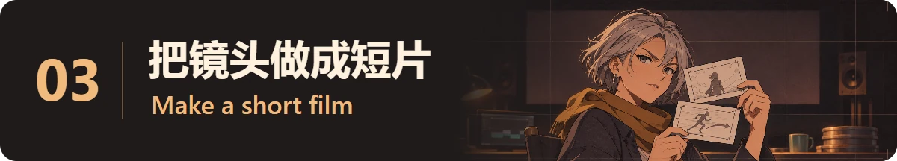
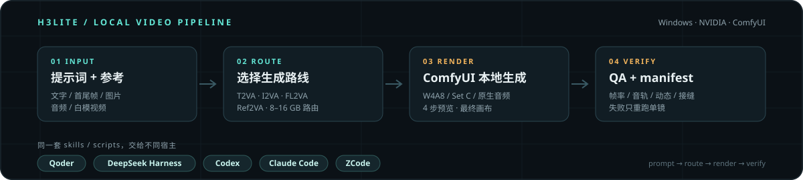
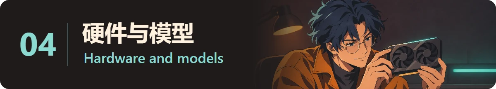
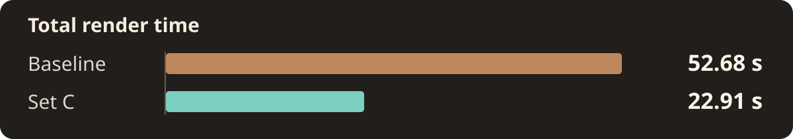
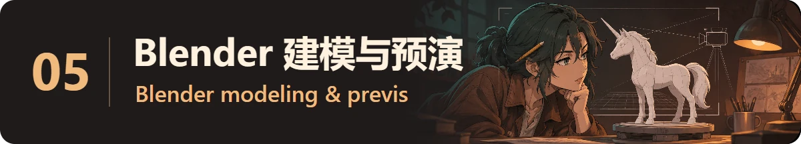
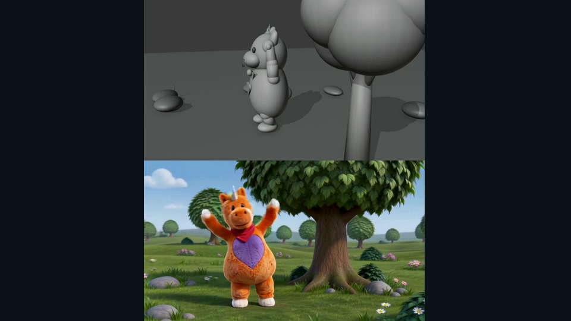

# H3 Lite

<p align="center">
  <picture>
    <source media="(prefers-reduced-motion: reduce)" type="image/webp" srcset="assets/readme/hero-still.webp">
    <source media="(max-width: 640px)" type="image/webp" srcset="assets/readme/hero-mobile.webp">
    
  </picture>
</p>

<p align="center">
  
</p>

<p align="center">
  <strong>中文</strong> | <a href="README.en.md">English</a> | <a href="https://github.com/Rimagination/h3lite/blob/v0.2.0/qoder-plugin/CHANGELOG.md#新能力">更新说明</a>
</p>

**H3 Lite 让你在自己的电脑上制作有声 AI 视频。** 告诉 AI 助手你想拍什么，或给它一张图作为开场。助手会根据你的显卡选择合适的方案，用 MiniMax H3 生成带环境声、音效或对白的片段。想做一条多镜头短片，也可以用 H3 Lite 做分镜和预演，再逐镜生成和剪辑。

<p align="center">
  <a href="#先看样片">看样片</a> · <a href="#快速开始">快速开始</a> · <a href="#多镜头制作">多镜头制作</a> · <a href="#硬件与模型">硬件与模型</a> · <a href="#blender-建模与预演">Blender 建模</a>
</p>

<a name="先看样片"></a>

## 

点封面播放，记得打开声音。这些是项目实际生成的片段，音轨随画面一起生成。

<table>
  <tr>
    <td align="center" width="50%">
      <a href="https://rimagination.github.io/h3lite/?video=case-red-ball"></a><br>
      <strong>红球弹跳</strong><br><sub>5 秒试跑 · 听撞击声和滚动声</sub>
    </td>
    <td align="center" width="50%">
      <a href="https://rimagination.github.io/h3lite/?video=case-golden-retriever"></a><br>
      <strong>金毛幼犬醒来</strong><br><sub>分段提示 · 从睡着到醒来</sub>
    </td>
  </tr>
  <tr>
    <td align="center" width="50%">
      <a href="https://rimagination.github.io/h3lite/?video=case-familyguy"></a><br>
      <strong>客厅换台</strong><br><sub>图生视频 · 从指定画面开始</sub>
    </td>
    <td align="center" width="50%">
      <a href="https://rimagination.github.io/h3lite/?video=case-starship-jump"></a><br>
      <strong>星舰跃迁</strong><br><sub>8 秒文生视频 · 转场和跃迁音效</sub>
    </td>
  </tr>
</table>

[打开完整画廊，查看 ZCode / Qoder 样片](https://rimagination.github.io/h3lite/) · [对比 Set A 的不同加速设置](https://rimagination.github.io/h3lite/?video=seta-lightx2v-compat)

<a name="快速开始"></a>

## 

首次使用从 **Windows + NVIDIA** 开始。H3 Lite 用 ComfyUI 在本机出片，已有可用的安装就能复用。插件和模型分开安装，模型下载入口见[硬件与模型](#硬件与模型)。

### 1. 把 H3 Lite 装进你的 AI 助手

| 你用什么 | 从哪里开始 |
| --- | --- |
| **Codex / Claude Code** | 单段视频从根目录的 [`SKILL.md`](SKILL.md) 开始，保留旁边的 `scripts/`、`references/` 和 `assets/`。需要完整制作流程时，从 [六个独立 Skill](qoder-plugin/skills/) 选用所需目录。 |
| **Qoder** | 下载 [v0.2.0 插件 ZIP](https://github.com/Rimagination/h3lite/releases/download/v0.2.0/h3lite-0.2.0.zip)，按[安装说明](qoder-plugin/README.md#安装与升级)配置。 |
| **DeepSeek Harness** | 下载或克隆仓库，在 **Plugins → Add plugin** 选择本地 `dsh-plugin` 目录。[接入说明](dsh-plugin/README.md#安装到-dsh) |
| **标准 MCP 客户端** | 用 Node.js 启动随仓库提供的 MCP 服务，指向本机 ComfyUI。[启动与配置](dsh-plugin/README.md#可选标准-mcp) |

### 2. 先检查电脑，再准备模型

把下面这段话交给能访问本机文件和终端的 AI 助手。

```text
请读取 https://github.com/Rimagination/h3lite 的 README。
我想先跑通一个 5 秒、带原生声音的样片。请检查显卡、内存、磁盘和已有的 ComfyUI，
按硬件推荐组件集并复用可用环境。需要下载模型时，先告诉我大小和保存位置。
```

### 3. 生成 5 秒红球样片

这条片只需要看三件事：球有没有弹跳两次、两次撞击有没有声音、MP4 能不能正常播放。

```text
请用 H3 Lite 生成 5 秒横屏视频，640×352，使用快速档和原生音频。
固定低机位。一颗哑光红色橡胶球在灰色混凝土地面上弹跳两次，再向右滚出画面。
保留两次撞击声和滚动声，不配音乐。完成后告诉我 MP4 的位置，并检查时长、音轨和画面运动。
```

<a name="多镜头制作"></a>
<a name="新版工作流"></a>

## 

**用 v0.2.0 做短片，可以先定分镜和角色设定，再逐镜生成、检查和剪辑。** 需要规划复杂机位或走位时，可以先做 [Blender 白模预演](#blender-建模与预演)。

<p align="center">
  
</p>

| 你想做什么 | 用哪个 Skill |
| --- | --- |
| 检查显卡，准备模型和 ComfyUI | [`h3-workstation`](qoder-plugin/skills/h3-workstation/SKILL.md) |
| 把想拍的画面、动作和声音写成提示词 | [`h3-prompt`](qoder-plugin/skills/h3-prompt/SKILL.md) |
| 拆分镜头，保持角色、场景和声音一致 | [`h3-director`](qoder-plugin/skills/h3-director/SKILL.md) |
| 用 Blender 白模排机位和动作，导出参考视频 | [`h3-whitemodel`](qoder-plugin/skills/h3-whitemodel/SKILL.md) |
| 逐镜生成，检查帧数、运动和音轨 | [`h3-generate`](qoder-plugin/skills/h3-generate/SKILL.md) |
| 拼接、加字幕、调响度和放大成片 | [`h3-post`](qoder-plugin/skills/h3-post/SKILL.md) |

批量制作时，`show.json` 记录镜头计划，`canon.json` 留下角色、声音和场景设定。Showrunner 按计划逐镜生成，跑到一半停了也能跳过已经验收的镜头。[多镜头项目示例](qoder-plugin/skills/h3-generate/assets/show.example.json)

<details>
<summary><strong>用命令行保存 ComfyUI 路径并续跑多镜项目</strong></summary>

在仓库根目录运行。把示例路径换成实际 ComfyUI 目录，`--write-config` 会将其写入 `~/.h3lite/config.json`。

```powershell
python qoder-plugin/skills/h3-workstation/scripts/h3_doctor.py --comfyui "D:/MiniMax-H3/ComfyUI" --write-config
```

完成 `show.json`、`canon.json` 和参考素材准备后，下面的命令会先检查计划与参考指纹，再继续未完成的镜头。

```powershell
python qoder-plugin/skills/h3-generate/scripts/h3_showrunner.py --spec projects/ep01/show.json --strict --check-sha --resume
```

从 [`show.json` 示例](qoder-plugin/skills/h3-generate/assets/show.example.json)和[多镜项目规范](qoder-plugin/skills/h3-generate/references/show-contract.md)开始。

</details>

### 按手头的素材选生成方式

| 你想控制什么 | 给助手的素材 | 对应路线 |
| --- | --- | --- |
| 从文字构思一个场景 | 按时间顺序描述画面、动作和声音 | `T2VA` |
| 从指定画面接着拍 | 一张开场图，加上之后发生的事 | `I2VA` |
| 从一个画面走到另一个画面 | 首尾两张图，以及中间的动作和运镜 | `FL2VA` |
| 沿用角色、动作或音色 | 至少一张参考图，可加视频或音频，并说明各素材的用途 | `Ref2VA` |

可下载[客厅换台的原始首帧](assets/examples/h3lite-i2va-familyguy-first-frame.png)，或查看 [MiniMax 官方 Ref2VA 输入素材](https://rimagination.github.io/h3lite/?video=case-pink-lamb-reference)。[提示词写法与示例](qoder-plugin/skills/h3-prompt/references/prompt-writing.md)

<a name="硬件与模型"></a>

## 

先按 **NVIDIA 显卡的显存**选一组模型。系统内存和工作流也会影响可用分辨率。先跑通 640×352，再尝试更大的画面。

| 你想从哪里开始 | 组件集 | 下载 |
| --- | --- | --- |
| **8 GB 显存**。在带 32 GB 内存的 RTX 4070 Laptop 上验证 | **Set A** · 低显存 | [百度网盘](https://pan.baidu.com/s/1IBlH0VY7tWGvxqMtniraow) · `4hri` |
| **16 GB 显存**。在带 32 GB 内存的 RTX 4060 Ti 上验证 | **Set B** · FP8 兼容 | [百度网盘](https://pan.baidu.com/s/1x5GGuJv0h8chApgVoDgIaQ) · `1hjx` |
| **16 GB 加速档**。先装 Set B，再加 Set C | **Set C** · 在支持的画布和组件齐全时自动启用 | [下载与校验说明](qoder-plugin/README.md#set-c-资产网盘) |

走 Set C 的 Ref2VA 路线时，再按下载说明补齐参考生成所需的权重。

### Set C 能省多少时间？

同一台 RTX 4060 Ti 16 GB 上，生成 **640×352、124 帧、4 步**的短片，记录的总耗时从 **52.68 秒**降到 **22.91 秒**。更大的画面、更长的镜头和不同硬件会改变耗时。[实测条件与其他尺寸](qoder-plugin/skills/h3-workstation/references/deployment-matrix.md#validated-16-gb-acceleration-ladder-2026-11-19-set-c-overlay)

<p align="center">
  
</p>

<details>
<summary><strong>平台边界、接缝和显存排查</strong></summary>

- **其他平台。** Apple Silicon 可参考独立的 [MLX 社区实现](https://huggingface.co/yunfengwang/mmh3turbo-bundles)。Linux + NVIDIA 与 Intel Mac 的本项目流程尚未验证。
- **平滑背景出现网格。** Set C 的 Sol VAE 可能留下 128 px 固定接缝。先跑 `h3_grid_check.py`，疑似时用 `--video-vae` 单独切换到标准 FP16 视频 VAE。[组件与实测](qoder-plugin/skills/h3-workstation/references/component-sets.md)
- **RTX 50 系出现纹理异常或提示词失效。** 先用同种子、两条提示词跑小样。量化路径异常时，按部署矩阵确认适用的 FP8 DiT 绕行方案。[Blackwell 排查](qoder-plugin/skills/h3-workstation/references/deployment-matrix.md#blackwell-and-quantized-h3-known-upstream-risk)
- **显存不足或长任务中断。** 16 GB 路线建议逐镜串行。排查同机其他 CUDA 进程和模型驻留，长视频拆成多镜并保留每镜 manifest。[显存排查](qoder-plugin/skills/h3-workstation/references/gpu-contention.md)

</details>

<a name="blender-建模与预演"></a>

## 

想让相机绕过主体，或让角色沿着一条路线移动，可以先在 Blender 里用简单几何体搭出角色、道具和场景。这就是**白模**。把走位、动作和相机做成一段预演视频，再交给 H3 作为运动参考。

<p align="center">
  <a href="https://rimagination.github.io/h3lite/?video=zcode-blender-unicorn-compare"></a>
  <br>
  <a href="https://rimagination.github.io/h3lite/?video=zcode-blender-unicorn-compare"><strong>播放独角兽玩偶广播体操 · 10.8 秒</strong></a>
  <br>
  <sub>上半屏是 Blender 白模，下半屏是 H3 画面。可以对照看运镜和伸展动作。</sub>
</p>

### 从白模到成片

1. **搭场景、排机位。** 用 `h3-whitemodel` 摆好主体、地面和道具，给动作与相机加关键帧。在 Blender 里先看一遍，确认构图和遮挡。
2. **用 Ref2VA 生成。** 把白模视频交给 H3 当动作和运镜参考，再给一张角色参考图和画面提示词。角色外观和材质由参考图与提示词引导。
3. **回看对照。** 检查镜头有没有绕到预期位置，主体有没有被挡住。H3 可能会重排动作节奏，预留一次成片检查。

[Blender 工作流](qoder-plugin/skills/h3-whitemodel/SKILL.md) · [把白模视频接进 Ref2VA](qoder-plugin/skills/h3-whitemodel/references/h3-video-reference.md) · [画廊中的 Blender 案例](https://rimagination.github.io/h3lite/#blender-gallery)

## 文档与许可

- [模型与节点清单](qoder-plugin/skills/h3-workstation/references/component-sets.md) · [部署矩阵](qoder-plugin/skills/h3-workstation/references/deployment-matrix.md) · [视频放大与交付](qoder-plugin/skills/h3-post/references/video-upscale.md)
- [MiniMax H3 官方仓库](https://github.com/MiniMax-AI/MiniMax-H3) · [ComfyUI 官方教程](https://docs.comfy.org/tutorials/video/minimax/minimax-h3) · [GitHub Issues](https://github.com/Rimagination/h3lite/issues)

本仓库使用 [MIT License](LICENSE)。MiniMax 权重、ComfyUI 和第三方节点各自适用其上游许可证。

## 作者名片

<p align="center">
  <a href="assets/readme/author-card.webp">
    
  </a>
</p>

## Star History

<p align="center">
  <a href="https://www.star-history.com/?repos=Rimagination%2Fh3lite&amp;type=date&amp;legend=top-left">
    <picture>
      <source media="(prefers-color-scheme: dark)" srcset="https://api.star-history.com/svg?repos=Rimagination%2Fh3lite&amp;type=date&amp;legend=top-left&amp;theme=dark">
      
    </picture>
  </a>
</p>

[查看交互版 Star History](https://www.star-history.com/?repos=Rimagination%2Fh3lite&type=date&legend=top-left)
